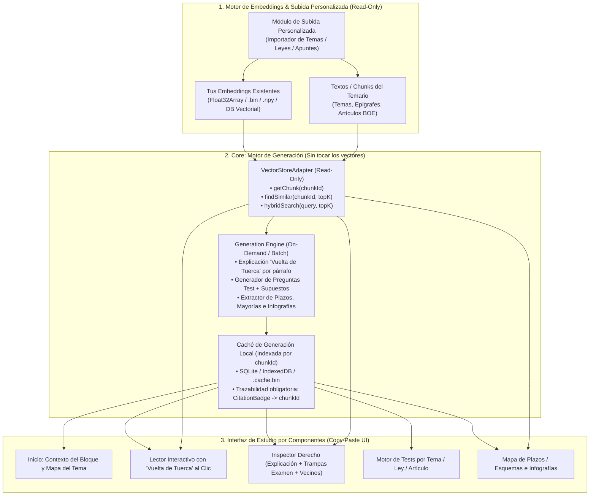

# Mockup-Opos — Arquitectura del `Study-Core` Reutilizable (Motor de Generación + Embeddings Read-Only)

Documento de diseño y especificación técnica para reutilizar la arquitectura de **EU AI Act Studio** en una plataforma de estudio, explicación e interrogación de **Temarios de Oposiciones** (con volúmenes masivos de texto, múltiples leyes y temas personalizados), manteniendo **tus embeddings y datos vectorizados 100 % intactos (Read-Only)**.

---

## 1. Principio Rector: Vectores Intocables + Motor de Generación Desacoplado

El `core` se diseña como una **plantilla portátil (copy-paste entre proyectos)** dividida en 3 capas independientes que se comunican únicamente mediante el identificador del fragmento (`chunkId`):



### Reglas Inquebrantables del `Core`
1. **Cero mutación de tus vectores:** El `core` **nunca** añade campos de interfaz dentro de tus vectores ni te obliga a re-vectorizar cuando mejoras un prompt o generas nuevas explicaciones/tests.
2. **Enlace débil por `chunkId`:** Todo lo que produce el **Motor de Generación** (explicaciones de párrafos, infografías, preguntas tipo test, reglas mnemotécnicas) se almacena en una capa separada (`generated-store`) apuntando al `chunkId` original.
3. **Trazabilidad 100 % verificable (`CitationBadge`):** Como cada generación nace de uno o varios `chunkId` recuperados por tu motor vectorial, cada tarjeta generada incluye automáticamente la referencia exacta (`Tema 12 · Epígrafe 3 · Art. 21 Ley 39/2015`) con salto directo al párrafo y enlace oficial al BOE.

---

## 2. Personalización de Subida e Ingesta (`Upload & Syllabus Customizer`)

Para que el usuario pueda añadir su propio material de estudio (temas de academia, leyes del BOE actualizadas, resúmenes propios) o conectar una base de datos ya vectorizada:

### 2.1. Dos modos de entrada admitidos
1. **Modo A — "Ya tengo mis Embeddings y Chunks" (Conexión Directa):**
   - Seleccionas en la aplicación la carpeta o archivo donde residen tus vectores (`.bin`, `.npy`, `.parquet`, `.jsonl` o SQLite) y el catálogo de textos (`chunks.json` / `.bin`).
   - El `VectorStoreAdapter` lee automáticamente de la cabecera la dimensión de tus embeddings (`128`, `384`, `768`, `1024`, `1536`) y monta el índice en memoria (`Float32Array`) sin recalcular nada.
2. **Modo B — "Subida Personalizada de Nuevos Temas o Leyes" (Ingesta Incremental):**
   - Panel de subida drag-and-drop en la app para importar:
     - **Temas propios** (`.md`, `.txt`, `.docx`, `.pdf` limpio) organizados por `Bloque > Tema > Epígrafe > Párrafo`.
     - **Leyes oficiales del BOE** mediante su identificador (`BOE-A-2015-10565` LPAC, `BOE-A-1978-31229` Constitución, `BOE-A-2015-11719` TREBEP) descargando el XML consolidado oficial.
   - **Segmentación inteligente por unidad clicable:** Divide cada tema o ley en **párrafos/apartados numerados** (`tema_04.ep_2.p_3` o `art_53.p1`) para que cada párrafo sea clicable individualmente en el Lector Interactivo.
   - **Conexión al Motor de Embeddings:** Invoca tu pipeline de embeddings (modelo local ONNX/Ollama/Transformers.js o API externa) **solo para los fragmentos nuevos**, anexando los nuevos vectores al final del `Float32Array` sin recalcular el resto del temario.

---

## 3. Contrato Técnico del Motor de Embeddings (`VectorStoreAdapter`)

Este único archivo adaptador es lo único que conecta tus datos vectorizados con el `core`:

```typescript
// src/core/contracts/vectorAdapter.types.ts

export interface SyllabusChunk {
  chunkId: string;          // Ej: "tema_05.ep_2.p_1" o "BOE-A-2015-10565:art_21.p1"
  parentId: string;         // Ej: "tema_05" o "art_21"
  blockId: string;          // Ej: "bloque_I_constitucional" o "titulo_II"
  numberLabel: string;      // Ej: "1.", "2.a)", "Epígrafe 3.2"
  title: string;            // Ej: "Artículo 21. Obligación de resolver"
  officialText: string;     // Texto original íntegro del párrafo
  externalOfficialUrl?: string; // Ej: "https://www.boe.es/buscar/act.php?id=BOE-A-2015-10565#a21"
  vectorIndex: number;      // Fila dentro del Float32Array de embeddings
}

export interface VectorStoreAdapter {
  /** Dimensiones del embedding (ej. 384, 768, 1536) y total de vectores */
  readonly dimensions: number;
  readonly numVectors: number;

  /** Recupera un párrafo o tema por su ID sin tocar los vectores */
  getChunk(chunkId: string): Promise<SyllabusChunk | undefined>;

  /** Búsqueda por similitud coseno pura sobre tu Float32Array precalculado */
  findSimilarByChunkId(chunkId: string, topK?: number): Promise<{
    chunk: SyllabusChunk;
    cosineSimilarity: number;
  }[]>;

  /** Búsqueda híbrida (Vectorial + Léxica BM25 para números de artículo y plazos exactos) */
  hybridSearch(query: string, queryEmbedding?: Float32Array, options?: {
    topK?: number;
    blockFilter?: string[];
  }): Promise<{
    chunk: SyllabusChunk;
    score: number;
    cosineSimilarity: number;
    lexicalScore: number;
  }[]>;
}
```

### Escalabilidad para Temarios Masivos (50.000+ párrafos)
- **Índice vectorial en RAM (`Float32Array` o `Int8Array` cuantizado):** 50.000 vectores de 384 dimensiones cuantizados en `Int8` ocupan solo **`~19 MB` de RAM** y permiten barrido de similitud coseno en **`< 8 ms`** en macOS/Windows/Web.
- **Texto particionado por Tema (`Lazy Shards`):** El texto de los temas se guarda en fragmentos por bloque (`shards/bloque_01.bin`, `shards/bloque_02.bin`), cargándose bajo demanda cuando el opositor abre ese tema.

---

## 4. Contrato del Motor de Generación (`GenerationEngine`)

El **Motor de Generación** trabaja sobre cualquier `SyllabusChunk` que le entregue el adaptador vectorial y genera (bajo demanda al hacer clic o en lote en segundo plano) las piezas de estudio:

```typescript
// src/core/contracts/generationEngine.types.ts

export interface GeneratedParagraphStudy {
  chunkId: string;
  generatedAt: string;
  importanceLevel: 'critical_exam' | 'deadline_majority' | 'frequent_trap' | 'core_concept' | 'complementary';
  
  /** 1. Explicación clara ("Vuelta de Tuerca") */
  plainExplanation: string;

  /** 2. Enfoque de Examen Oficial (sustituye a "Implicación para la empresa") */
  examPerspective: {
    summary: string;
    byExamMode: {
      test_oficial: string;       // Cómo lo preguntan en el tipo test
      supuesto_practico: string;  // Cómo aplicarlo en el caso práctico
      desarrollo_oral: string;    // Puntos clave para cantar o redactar el tema
    };
    commonTraps: string[];        // Trampas típicas de tribunal (ej. "plazo en días hábiles vs naturales")
    mnemonicsAndDeadlines?: {     // Plazos, mayorías o reglas mnemotécnicas del párrafo
      rule: string;
      exactValue: string;
      citationChunkId: string;
    };
  };
}

export interface GeneratedQuizQuestion {
  id: string;
  sourceChunkId: string;
  blockId: string;
  topicId: string;
  difficulty: 'basico' | 'oficial_examen' | 'supuesto_practico';
  question: string;
  options: [string, string, string, string];
  correctOptionIndex: 0 | 1 | 2 | 3;
  explanation: string;
  examTrapNote: string;
  citations: {
    chunkId: string;
    displayLabel: string;
    exactQuote: string;
    externalUrl?: string;
  }[];
}

export interface GenerationEngine {
  /**
   * Genera o recupera de caché la explicación "Vuelta de Tuerca" de un párrafo
   * usando únicamente el texto del chunk + sus K vecinos vectoriales más cercanos.
   */
  generateParagraphInsight(
    chunk: SyllabusChunk,
    semanticNeighbors: SyllabusChunk[]
  ): Promise<GeneratedParagraphStudy>;

  /**
   * Genera preguntas tipo test y supuestos prácticos a partir de un conjunto de chunks
   * (un artículo, un epígrafe o un tema completo), garantizando cita exacta al chunkId.
   */
  generateQuizForChunks(
    chunks: SyllabusChunk[],
    options: { count: number; mode: 'test_oficial' | 'supuesto_practico' }
  ): Promise<GeneratedQuizQuestion[]>;

  /**
   * Extrae automáticamente todos los plazos, mayorías, órganos competentes o hitos
   * de un tema para poblar la vista de Línea de Tiempo / Esquemas de Plazos.
   */
  extractDeadlinesAndInfographics(chunks: SyllabusChunk[]): Promise<{
    deadlines: { label: string; duration: string; effectOfSilence?: string; chunkId: string }[];
    infographicNodes: { heading: string; summary: string; badge: string; chunkId: string }[];
  }>;
}
```

---

## 5. Qué Archivos Copiar y Pegar de este Proyecto al Nuevo Proyecto

| Archivo en `legal-helper` | Rol en el `Core` de Oposiciones | ¿Requiere cambios? |
| :--- | :--- | :--- |
| `src/services/vectorStore.ts` | Base del `VectorStoreAdapter` (`Float32Array`, similitud coseno, búsqueda híbrida BM25 + vectorial y resolución de URLs oficiales con `#ancla`). | Mínimo: añadir carga de shards por tema si supera 50 MB. |
| `src/components/shared/CitationBadge.tsx` | Píldora universal de trazabilidad con previsualización de cita literal y doble clic (lector interno + enlace oficial al BOE `#a21`). | **0 cambios** (reutilizable al 100 %). |
| `src/components/shared/RiskBadge.tsx` | Se parametriza con `oposicion.config.ts` para mostrar niveles de examen (`Pregunta Estrella`, `Plazo / Silencio`, `Trampa de Tribunal`, `Concepto Base`). | Solo cambiar el diccionario `RISK_METADATA`. |
| `src/components/shared/SectionCard.tsx`, `SegmentedFilterBar.tsx`, `SplitViewLayout.tsx`, `StatMetricCard.tsx` | Sistema de diseño modular macOS/Web/Windows con soporte nativo para Modo Oscuro y Modo Claro. | **0 cambios** (reutilizables al 100 %). |
| `src/components/legal/ParagraphInspector.tsx` | Panel derecho de *"Vuelta de Tuerca"* al clicar cualquier párrafo del tema o artículo, mostrando la salida del `GenerationEngine` + los vecinos semánticos de tus vectores. | Conectar a `generateParagraphInsight(chunkId)`. |
| `src/components/legal/CommandPaletteModal.tsx` | Buscador global instantáneo `Cmd+K` sobre toda tu base vectorial. | **0 cambios** (reutilizable al 100 %). |
| `src/views/InteractiveLawView.tsx` | Lector interactivo del temario/legislación párrafo a párrafo con `content-visibility: auto`. | **0 cambios** (sirve para Temas y para Leyes). |
| `src/views/QuizEngineView.tsx` | Simulador de tests por Bloque, Tema o Artículo con Modo Estudio y Modo Examen cronometrado + botón *"Generar nuevas preguntas de este tema"*. | Añadir botón que invoca `generateQuizForChunks`. |

---

## 6. Flujo de Trabajo para Arrancar el Proyecto de Oposiciones

1. **Copiar el esqueleto UI + Servicios** (`src/components/`, `src/views/`, `src/services/vectorStore.ts`, `src/index.css`).
2. **Conectar tu carpeta de Embeddings** mediante `VectorStoreAdapter` (apuntando a tus ficheros de vectores y textos sin modificarlos).
3. **Configurar el proveedor del `GenerationEngine`** (API de Gemini / Claude / OpenAI o modelo local con caché persistente en disco por `chunkId`, de modo que cada párrafo o test generado una vez quede guardado instantáneamente para el estudio offline).
4. **Compilar para macOS (`.app`), Windows (`.exe`) o Web (`dist/`)** con el mismo código base.
